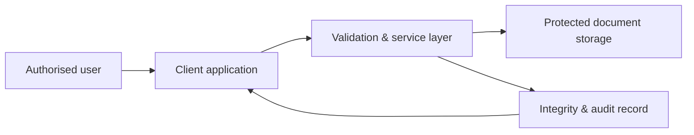

# Document Ledger — showcase

**A private document-workflow project, represented here only as a public portfolio case study.**

Document Ledger reflects my work on trusted business workflows: making document lifecycles easier to follow while keeping privacy, integrity, and accountability central.

## Focus

- Privacy-conscious document and evidence workflows
- Clear audit and verification journeys
- Trust integrations and product-focused system design

## Technology signals

**React · Vite · TypeScript · Node.js · PostgreSQL · Object storage · Wallet connectivity**

## Public boundary

This repository intentionally contains no source code, documents, access rules, storage design, integrations, credentials, schemas, infrastructure, or customer information. It is a concise portfolio overview—not a document custody service.

© Chidiebere Offor.
