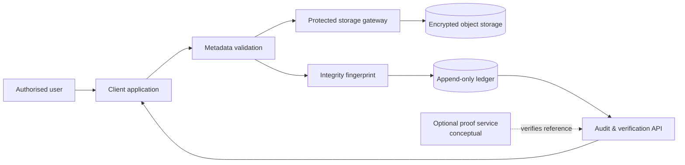

# Architecture notes

## Lifecycle at a glance

The objective is not to place sensitive documents into an audit system. It is to capture an integrity record and an accountable lifecycle around a protected object.

## Public-safe design principles

1. **Store the minimum evidence.** Keep document content out of the ledger; record a reference, a hash, timestamps, and authorised lifecycle events.
2. **Separate storage from proof.** Object protection, identity, and integrity verification have different failure modes and should not be collapsed into one component.
3. **Treat audit history as a product feature.** A user should be able to understand what happened, when, and through which authorised action.
4. **Defence in depth.** Hashing complements—not replaces—access controls, encryption, retention rules, monitoring, and key management.

## Exclusions

The diagram does not disclose the project's storage layout, permission model, cryptographic key handling, integration configuration, endpoints, on-chain contracts, document formats, or operational controls.
