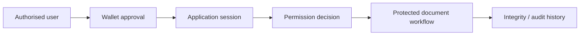

# Verification and wallet workflow — public reference

This document describes the **responsibilities** represented by Document Ledger Professional. It is not source code, a deployment guide, or a disclosure of client architecture.

## What the private project represents

The product combines a document-centric workflow with wallet-connected verification. Its central engineering concern is not simply connecting a wallet: it is keeping a user session, a wallet identity, permission decisions, document access, and the audit trail distinct and understandable.

## Public-safe design observations

- A wallet connection is evidence of control of an address; it is not, by itself, a complete application authorisation decision.
- A durable workflow benefits from explicit lifecycle states and role-gated actions rather than implicit status changes.
- Document content, access decisions, and integrity evidence should have separate protection and retention concerns.
- Session restoration needs to confirm that an approval session is still valid before recreating the signer context.

## What is deliberately excluded

This reference omits the application source, data model, roles, operational rules, API routes, session details, certificate format, storage configuration, credentials, and all client records. It does not claim an on-chain document registry or public deployment.
